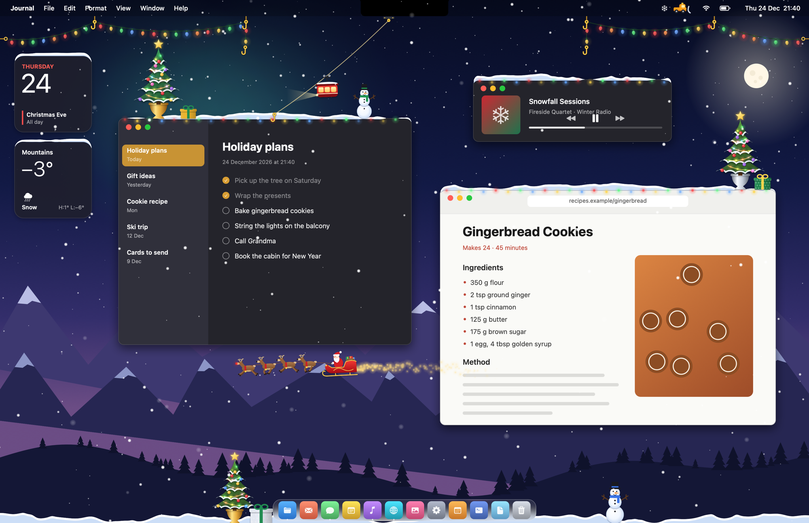
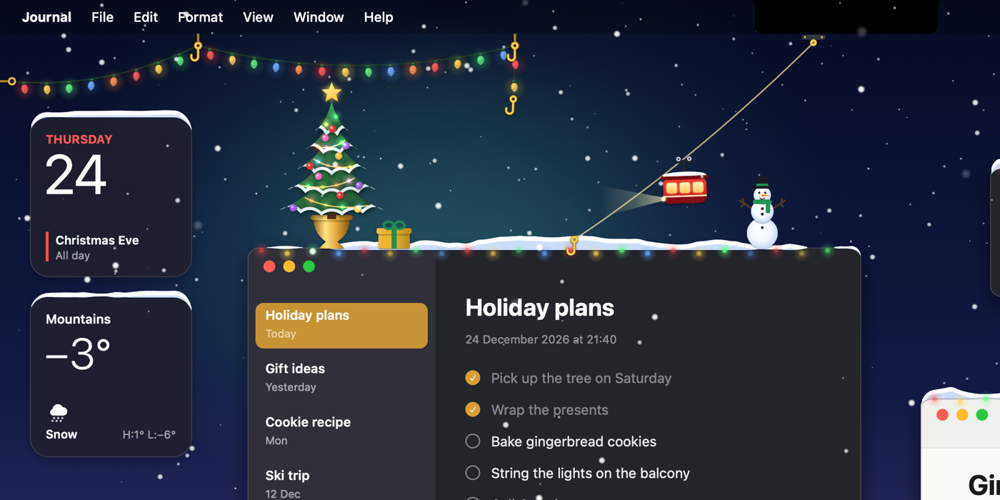
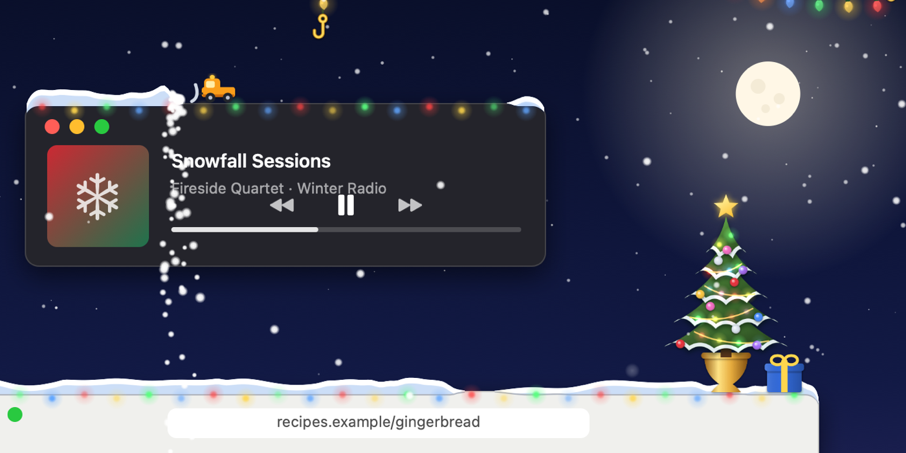
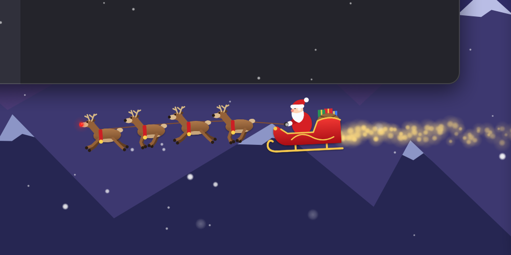
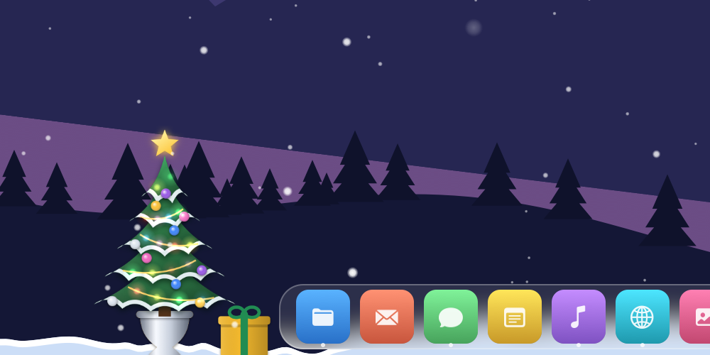

# X-Snow: Snow for the Mac Desktop

**Snow on your Mac.** X-Snow is a little menu bar app that makes it snow over your desktop. The snow settles on the tops of your windows, on widgets and along the bottom of the screen, where it tucks in behind the Dock. You can put out Christmas trees and snowmen, hang strings of lights, send a snow plow along a window, and every so often Santa flies across.

<p align="center">
  
</p>

<table>
  <tr>
    <td width="50%" valign="top">
      
      <br><sub><b>Lights and the cable car.</b> Strings hang from the sides of the screen and drape along the top. The rope hangs from the notch and hooks onto a window.</sub>
    </td>
    <td width="50%" valign="top">
      
      <br><sub><b>Snow on windows.</b> It settles along every top edge, with fairy lights under it. The plow scrapes a window clean and throws the snow off.</sub>
    </td>
  </tr>
  <tr>
    <td width="50%" valign="top">
      
      <br><sub><b>Santa.</b> Every so often his sleigh crosses the screen, with Rudolph in front.</sub>
    </td>
    <td width="50%" valign="top">
      
      <br><sub><b>The bottom of the screen.</b> Snow piles up along the bottom and lies behind the Dock, showing through its glass.</sub>
    </td>
  </tr>
</table>

<sub>X-Snow itself drew the snow, decorations, lights, plow and Santa, and its debug snapshot saved them. The wallpaper, windows, widgets, Dock and menu bar behind them are a staged desktop: X-Snow never asks for Screen Recording, so it can't capture the real screen.</sub>

- **Platforms:** macOS 14.0+
- **Language:** Swift with AppKit and SpriteKit. No third-party dependencies, no image files: every picture is drawn in code.
- **Privacy:** no network, no Screen Recording permission. Accessibility is optional.
- **Status:** a working app (see [Status](#status-what-is-verified-and-what-isnt)).

---

## Contents

1. [What it does](#what-it-does)
2. [How it works](#how-it-works)
3. [Design](#design)
4. [Privacy](#privacy)
5. [Technologies](#technologies)
6. [Project structure](#project-structure)
7. [Build and run](#build-and-run)
8. [Status: what is verified and what isn't](#status-what-is-verified-and-what-isnt)

---

## What it does

X-Snow lives behind a snowflake in the menu bar. It has no Dock icon and no windows of its own.

- **Snowfall.** Off, Light, Medium or Heavy, plus Wind from Off to Strong.
- **Snow that settles.** Flakes pile up on window tops, desktop widgets and the bottom of the screen.
- **Decorations.** Christmas trees, snowmen, stockings, cookies and gifts. Drag them where you like, and right-click one to remove it.
- **Snow plow.** It waits next to the snowflake in the menu bar. Drag it onto a window and it drives along the top, scraping the snow off, then goes back.
- **Cable car.** A rope hangs from the notch with a hook on the end. Hook it onto a window and a cable car rides between the two.
- **Lights.** Strings of old-fashioned bulbs hang from the sides of the screen. Drag a hook to drape them along the top.
- **Santa.** Turn him on and his sleigh, with four reindeer and Rudolph in front, flies across the screen.

Clicks pass straight through the snow to your apps, unless the pointer is on something you can grab. Grabbing a tree never takes focus from the app you're working in.

---

## How it works

### Overlays (`X-Snow/Overlay.swift`)

Each screen gets two see-through, non-activating panels. The main one floats above every app and holds the snow scene. The second sits just below the Dock, so snow along the bottom can tuck in behind the Dock's glass.

### Where snow can land (`X-Snow/WindowTracker.swift`, `X-Snow/Dock.swift`)

`WindowTracker` reads the frames of the windows and widgets on screen (frames only, no window contents). Each top edge becomes a `Platform` that snow, decorations, the plow and the hooks can rest on. With Accessibility allowed, the Dock reports its exact frame. Without it, its width is estimated.

### Snow (`X-Snow/Snowfall.swift`, `X-Snow/SnowPile.swift`)

Each platform's width is cut into thin columns, and each column remembers how high its snow is. Flakes that land add to a column.

### The scene (`X-Snow/SnowScene.swift`)

One SpriteKit scene per screen draws everything: falling snow, the piles, and on the main screen the decorations, cable cars, lights, plow and Santa. X-Snow asks macOS not to slow it down while it's in the background, so the snow stays smooth.

---

## Design

- **Drawn in code.** `Art.swift` draws every tree, snowman, bulb, reindeer and sleigh at three pixels per point, so nothing goes blurry when a tree tilts. Each tree comes out a little different.
- **Things rest on things.** Decorations, the plow and the hooks stand on whatever window or widget is under them.
- **Out of the way.** Nothing steals focus, and everything stays below menus and notifications.

---

## Privacy

- No network code.
- No Screen Recording permission. X-Snow only reads window frames, never what's inside them.
- Accessibility is optional and only used to find the Dock's exact size.
- Settings are saved in UserDefaults.

---

## Technologies

| Area | Frameworks and techniques |
| --- | --- |
| Language | Swift, main-actor default isolation with Approachable Concurrency |
| Rendering | SpriteKit scenes in transparent `SKView`s |
| Windows | AppKit non-activating panels, Quartz window list |
| Dock | Accessibility API (optional) |
| Art | Every sprite drawn with Core Graphics at launch |
| Menu | `NSStatusItem` with an `NSMenu` |

---

## Project structure

```
X-Snow/
├── X-Snow/
│   ├── XmasApp.swift        Menu bar item, menu, one overlay per screen
│   ├── Overlay.swift        The see-through panels
│   ├── SnowScene.swift      Everything drawn on one screen
│   ├── Snowfall.swift       Falling flakes and the platforms they land on
│   ├── SnowPile.swift       Snow lying on one edge
│   ├── WindowTracker.swift  Window and widget frames
│   ├── Dock.swift           Where the Dock sits
│   ├── TreeNode.swift       Trees, snowmen, stockings, cookies, gifts
│   ├── LightString.swift    Strings of lights
│   ├── Ropeway.swift        Rope, hook and cable car
│   ├── Plow.swift           The snow plow
│   ├── Santa.swift          Santa and the reindeer
│   ├── Art.swift            Every picture, drawn in code
│   └── Settings.swift       Saved preferences
├── X-Snow.xcodeproj
└── .github/                 Banner and README screenshots
```

---

## Build and run

Requirements: Xcode 27 on macOS. Open `X-Snow.xcodeproj`, pick the **X-Snow** scheme and run. The snowflake appears in the menu bar.

From the command line:

```bash
xcodebuild build -project X-Snow.xcodeproj -scheme X-Snow -configuration Debug
```

Debug builds can save a picture of the overlay: launch with `-snapshot <file.png>`, and optionally `-snapshotAfter <seconds>` and `-demo YES` to hang the lights, hook the rope and call Santa.

---

## Status: what is verified and what isn't

**Verified**

- Builds and runs on macOS. The screenshots were saved by the debug snapshot of that build, over a staged desktop.

**Not verified yet**

- Multiple screens and Spaces were not checked for this README.
- There is no unit test target.

---

© 2026 Alessandro Signorile. All rights reserved.
